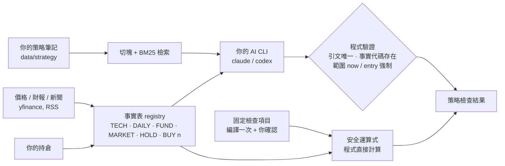

# Stock Dashboard — 把你的交易筆記，對照成當下的事實

**繁體中文** · [English](#english)

> **免責聲明**：本工具為個人研究輔助軟體，由程式與 AI 依公開資料整理資訊，**不構成任何投資建議或買賣邀約**，也**不保證獲利**。分析可能出錯、過時或自相矛盾；資料來自第三方，可能延遲或不完整；AI 可能產生不實內容。所有投資決策與風險由使用者自行承擔，作者非證券投資顧問，不對任何損失負責。


## 這是什麼

給**剛開始投資、看了很多教學、做了很多筆記，卻不知道「現在這檔股票符合筆記裡的哪幾條」**的人。

你把自己的交易規則（筆記）放進來，系統把它們對照到這檔股票**當下的事實**（價格、均線、RSI、財報、新聞、大盤、你的持倉），逐條給出「通過／未通過／未知」，並附上**出處原文與證據**。

它**不是**選股明牌，也**不預測**漲跌。五面向分數**尚無回測證據**顯示高分之後表現較好：技術面分數用 5 年歷史回測（[`scripts/backtest_technical.py`](scripts/backtest_technical.py)），與同儕相比沒有顯著差異；財報、估值、新聞三軸由 AI 判斷，無法回測。請把它當成「整理資訊、檢查自己有沒有照自己的規則做」的輔助。

## 立刻試試（不需要 AI 帳號）

```bash
git clone <this-repo> && cd stock_dashboard
docker compose up            # 或：./scripts/run_demo.sh（需要 Python 3.9+）
# 開 http://127.0.0.1:8013
```

示範模式使用**合成資料**（虛構的「示範公司 A–E」），不連網、不呼叫任何 AI；AI 分析、聊天與策略檢查的按鈕會停用，其餘功能（圖表、持倉、固定檢查項目、批次總覽、筆記管理）都能操作。

## 特色

| | |
|---|---|
| **引文由程式驗證** | 模型引用你筆記的每一句，程式逐字比對（必須存在、在所有筆記中唯一）；引用的事實代碼必須真的在事實表裡，證據文字由程式重新產生，不採信模型自己寫的。 |
| **「買入當時」與「現在」分開** | 你的每一筆買入，只用**買入日之前**的價格重算當時的趨勢、均線、停損幅度與風報比來檢查；不會拿今天的資料事後評價過去的買入。當時的財報、新聞、大盤沒有歷史資料就標為不可得，不編造。 |
| **固定檢查項目（釘選規則）** | 你直接輸入「停損不超過 7%」「RSI 超過 70 不追」；系統編譯成受限的運算式（本地範本優先，AI 協助為輔）、你確認解讀後，由**程式**每次判斷，不再花 AI 額度。無法程式判斷的（要看新聞、財報日曆、主觀判斷）誠實顯示「未知」。 |
| **批次總覽** | 一次比較多檔股票對你的規則的符合情形，釘選規則是固定欄位。 |
| **誠實的護欄** | 分數上限由程式強制（虧損公司、重挫股、週期股等），不是靠 prompt 請求；每個護欄觸發都留下紀錄。 |
| **本機優先** | 資料全在你的電腦；AI 呼叫使用**你自己登入的** `claude` 或 `codex` CLI；預設只綁 `127.0.0.1`。 |
| **K 線圖** | TradingView Lightweight Charts，含 MA10/20/50/200、成交量、畫趨勢線、買入點標記。 |
| **新手導覽** | 每個頁面第一次進入會用彈窗介紹功能。 |

<p align="center">
  
  
</p>
<p align="center">
  
  
</p>

## 它怎麼運作



- 技術面與大盤分數、護欄、釘選規則都是**程式計算**；只有「從筆記挑出適用規則並對照事實」這一步由 AI 做，而且結果要通過上面的驗證。
- 詳細設計取捨見 [docs/DESIGN.md](docs/DESIGN.md)。

## 在自己的電腦上使用真實資料

```bash
cd backend && pip install -r requirements.txt && cd ..
./scripts/run_local.sh               # http://127.0.0.1:8013 ，只綁本機
```

- 需要（選用）登入好的 [Claude Code](https://github.com/anthropics/claude-code) 或 [Codex CLI](https://github.com/openai/codex) 才能用 AI 功能。
- 把你的筆記（`.md`／`.txt`）放進網頁「策略筆記」或 `data/strategy/`；在個股頁輸入持倉；按「更新基本面分析」。
- 想從手機連：用 `scripts/run_tailscale.sh`（只綁 Tailscale 網卡）。**不要**用 `--host 0.0.0.0`，這個服務沒有登入驗證。

## 資料與隱私

- 你的觀察清單、持倉、筆記、分析、聊天紀錄都在 `data/`（已加入 `.gitignore`），不會被 commit。
- 持倉與分析內容會在你執行 AI 功能時，送到**你自己登入的** AI 服務（Claude 或 OpenAI）。第一次使用會顯示同意視窗。
- `claude` 的呼叫已關閉工具、外掛與 MCP；`codex` 以唯讀沙盒執行，但**不是**安全邊界（它仍可讀取整個檔案系統）。詳見 [SECURITY.md](SECURITY.md)。
- 每次 AI 呼叫的 token 與等效費用記在 `data/llm_usage.jsonl`。實測：完整分析約 0.15 USD、策略檢查約 0.13 USD（API 等值，訂閱方案不一定實際計費）。

## 誠實的限制

- 分數與護欄是依常理訂的規則，**沒有回測證據顯示預測力**（見上）。
- 資料來自 yfinance 與 Google News／Yahoo RSS，受其服務條款約束（個人使用）；可能延遲、缺漏，台股資料品質尤其不穩。
- LLM 可能誤判。程式只保證「引文存在、事實代碼存在」，**不保證**通過／未通過的判斷正確。
- 單人、本機工具：沒有帳號系統、沒有權限管理。
- 目前由作者自己使用，部分輸出用語與規則偏向作者的交易風格；可用 [profile](docs/DETAILS.zh-TW.md#自訂分析規則profile) 調整。

## 開發

```bash
python -m pytest -q tests           # 400+ 個測試，不需要網路
```

- 後端：FastAPI + yfinance；前端：原生 HTML/JS（無框架）＋ Lightweight Charts v4。
- CI 設定在 `.gitlab-ci.yml`（Python 3.9／3.11／3.12）。
- 完整功能說明與資料檔格式：[docs/DETAILS.zh-TW.md](docs/DETAILS.zh-TW.md)。
- 授權：[MIT](LICENSE)；第三方聲明見 [NOTICE](NOTICE)。

---

## English

**Stock Dashboard** compares *your own* trading notes with the *current facts* of a stock and shows which of your rules it meets — with the source quote and the evidence for every row.

> **Disclaimer:** research aid only. Not investment advice, no guarantee of results; AI output may be wrong or outdated. You alone are responsible for your decisions. The author is not a licensed investment adviser.

**Who it is for:** people new to investing who have collected lots of tutorials and notes but cannot tell which of their rules a stock meets right now.

**What it is not:** a stock picker or a predictor. The five-axis scores have **no backtest evidence** that high scores do better afterwards (the technical score was backtested on 5 years of history: no significant difference vs. peers; the three LLM-judged axes cannot be backtested without look-ahead).

### Try it (no AI account needed)

```bash
git clone <this-repo> && cd stock_dashboard
docker compose up        # or ./scripts/run_demo.sh (Python 3.9+)
# open http://127.0.0.1:8013
```

Demo mode serves **synthetic** data (fictional companies), never touches the network or an AI CLI; AI-dependent buttons are disabled.

### What makes it different

- **Verified quotes** — every quote the model cites must exist verbatim and uniquely in your notes; cited fact keys must exist in the facts registry; evidence text is regenerated by code, not trusted from the model.
- **"At purchase" vs "now"** — each of your buys is checked only with data from *before* the buy date (trend, moving averages, stop distance, risk/reward). No hindsight; unavailable history (fundamentals, news, market) is marked unavailable, never invented.
- **Pinned rules** — type "stop loss ≤ 7%" or "don't chase RSI > 70"; it is compiled once into a small safe expression (templates first, LLM-assisted otherwise), you confirm the reading, and from then on **code** evaluates it — deterministic, free of AI cost. Things code cannot judge (news, earnings calendar, subjective) show *unknown*, honestly.
- **Batch overview** — compare many tickers against your rules; pinned rules are stable columns.
- **Code-enforced guards** on scores (loss-making, crashed, cyclical names), each firing logged.
- **Local-first** — data stays on your machine; AI calls use *your own* logged-in `claude` / `codex` CLI; binds to `127.0.0.1` by default.

### Real use

```bash
cd backend && pip install -r requirements.txt && cd ..
./scripts/run_local.sh        # http://127.0.0.1:8013, localhost only
```

Optional: a logged-in [Claude Code](https://github.com/anthropics/claude-code) or [Codex CLI](https://github.com/openai/codex) for the AI features. The service has **no authentication** — never expose it with `--host 0.0.0.0`.

### Limits

Rules and caps are common-sense, not validated predictors. Data comes from yfinance and RSS feeds (personal-use terms, may be delayed or missing). The LLM can misjudge: code guarantees quotes and fact keys exist, **not** that a pass/fail verdict is right. Single-user, local tool.

### Development

`python -m pytest -q tests` (400+ tests, no network). FastAPI + vanilla JS + Lightweight Charts. See [docs/DESIGN.md](docs/DESIGN.md) for design decisions and [docs/DETAILS.zh-TW.md](docs/DETAILS.zh-TW.md) for the full (Traditional Chinese) reference. MIT licensed.
